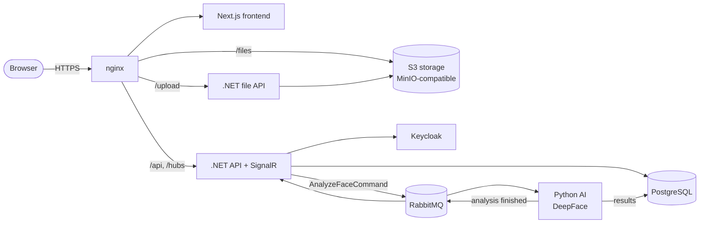

# 🕵️‍♂️ FBI - Advanced Surveillance & Face Recognition System

This is an educational project/simulation created for portfolio purposes. It is
not affiliated with the Federal Bureau of Investigation.

> **A distributed, event-driven microservices architecture for real-time
> tracking, reporting, and AI verification of wanted persons.**


[](LICENSE)


## 🎥 Demo

https://github.com/user-attachments/assets/ac250e78-cb73-4447-a52b-215ec3430325

## 🌍 Overview

Users browse wanted persons (imported from the public FBI API) and report
sightings: a photo plus a location on the map. The photo is analysed
asynchronously by a face-recognition service (DeepFace / Facenet) against an
index of known faces. Results and nearby-sighting alerts are pushed to
connected users in real time over SignalR.



The sighting flow, step by step, and every service, port and route are in
[docs/architecture.md](docs/architecture.md).

## 🛠️ Tech stack

| Area | Technology |
|---|---|
| Backend API | .NET 9, ASP.NET Core, EF Core (Npgsql), MassTransit, SignalR, FluentValidation, QuestPDF |
| Frontend | Next.js 16 (App Router), React 19, Tailwind CSS 4, react-leaflet, recharts |
| AI service | Python 3.11, FastAPI, DeepFace (Facenet), TensorFlow, pika |
| File API | .NET 10 minimal API, AWS S3 SDK |
| Identity | Keycloak 26 (OIDC) |
| Messaging | RabbitMQ 3.13 |
| Storage | PostgreSQL 17, S3-compatible object storage ([Silo](docs/prod/requirements.md#why-silo-and-not-miniominio), a MinIO fork) |
| Edge | nginx (TLS via Let's Encrypt / certbot) |
| Deployment | Docker Compose (dev and prod overlays), bash/PowerShell scripts |

## ✨ Key features

- **Centralized authentication** with Keycloak: roles `USER` and `ADMIN`.
- **Asynchronous face recognition**: RabbitMQ decouples the AI work from the
  API. Matches use cosine distance on Facenet embeddings.
- **Real-time updates** over SignalR: new sightings, processed reports, and
  alerts for users within 10 km of a sighting.
- **Maps** for sightings and routes, **statistics** and **PDF dossiers** for
  admins.
- **Daily import** of wanted persons from the public FBI API.

## 🚀 Quick start (local development)

Requirements: Docker (Docker Desktop on Windows/macOS) and Git.

```bash
git clone <repo-url> fbi && cd fbi
cp .env.example .env
scripts/dev-up.sh            # Windows PowerShell: .\scripts\dev-up.ps1
```

Then create a user in Keycloak at http://localhost:18080/admin/ (realm
`dotnet`; [how](docs/dev/keycloak.md)) and open **http://localhost:8088**.

Face recognition needs a face index built from the imported FBI data. Once
the first FBI import has finished (a few minutes after the first start), run
`scripts/sync-faces.sh --dev --full`. The app lists every imported wanted
person, but recognises only fugitives, by default the first 100
(`SYNC_MAX_PERSONS`, `SYNC_INCLUDE_CLASSIFICATIONS`)
([details](docs/dev/local-setup.md#required-after-the-first-start-fbi-import-then-the-face-index)).

The first build takes a while (the AI image includes TensorFlow). More in the
[development guide](docs/dev/README.md).

## 📚 Documentation

| | |
|---|---|
| [Architecture](docs/architecture.md) | Diagrams, services and ports, sighting → face recognition → SignalR flow, nginx routes, the Python ↔ EF Core coupling |
| [Development](docs/dev/README.md) | Local setup (Docker and per service), environment variables, Keycloak, EF migrations, manual testing, troubleshooting |
| [Production](docs/prod/README.md) | VPS requirements, DNS, server setup, TLS, first deploy, Keycloak, admin consoles over SSH, updates and rollback, backup/restore, monitoring, security checklist |

HTML versions with navigation and rendered diagrams: run
`scripts/build-docs.sh` (or `.ps1`), then open `docs/html/index.html`.

## 🗂️ Repository layout

```text
fbi-backend/               .NET 9 main API (REST, SignalR, EF Core migrations, FBI scraper)
fbi-frontend/              Next.js frontend
face-recog-microservice/   Python face-recognition worker (RabbitMQ consumer + FastAPI)
fbi-media-service/         .NET 10 file upload API (S3)
nginx/                     nginx image, snippets and dev/prod config templates
keycloak/                  realm imported on first start
postgres-init/             creates the Keycloak database on first start
scripts/                   dev/prod scripts (up, deploy, update, SSL, backup, restore, healthcheck...)
docs/                      documentation (Markdown sources)
docker-compose.yaml        shared base; combined with docker-compose.dev.yml or docker-compose.prod.yml
```

## 📝 License

Distributed under the MIT License. See [LICENSE](LICENSE).

---

*Built with ❤️ by Silviu Dinca*
