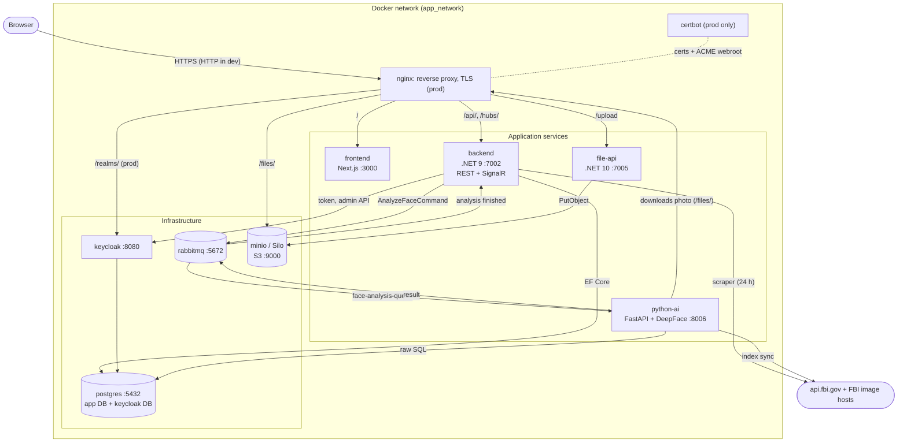
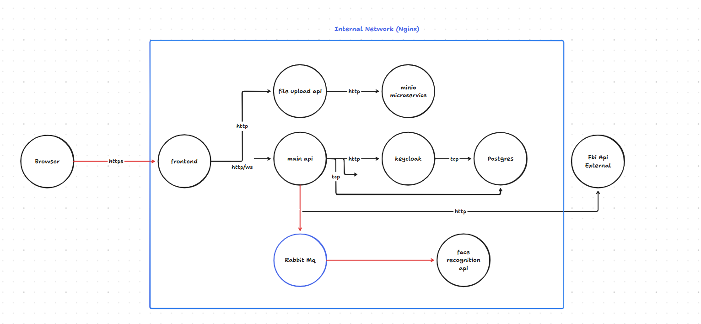
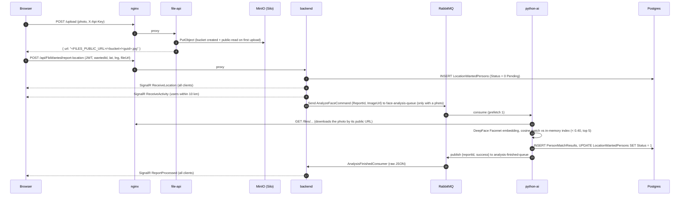

# Architecture

This page describes how the services fit together, as implemented in the code
(compose files, nginx templates, `Program.cs`, `main.py`). For setup, see
[Development](dev/README.md) and [Production](prod/README.md).

## System diagram



The browser talks only to nginx. In the browser, the frontend calls the backend
(`/api/`, `/hubs/`) and the file API (`/upload`) directly, through nginx. The
Next.js server does not proxy these calls. Login is server-side: the backend
performs the Keycloak password grant, so the browser never talks to Keycloak.

### Differences from the original diagram

The hand-drawn diagram ([`arhitectura.png`](arhitectura.png)) is kept for
reference:



Compared with the code, it differs as follows:

- It shows **frontend → file API** and **frontend → main API** as server-side
  calls. In reality the **browser** makes these calls through nginx (client
  components).
- **nginx** is only the label of the frame, not a node; **certbot** is missing.
- Missing edges: **python-ai → Postgres** (raw SQL writes, the most important
  coupling), **python-ai → RabbitMQ** (`analysis-finished-queue`; the RabbitMQ
  arrow is one-directional), **python-ai → `/files/`** (photo download),
  **python-ai → FBI image URLs** (index sync), and **backend → browser**
  (SignalR).
- One arrow from the main API has no target. A direct HTTP call from the main
  API to face recognition (`/fast-search`) does not exist in practice: it is
  commented out in `WantedPersonsService`.

## Services

| Compose service | Source / image | Internal port | Depends on (healthy) | Persistent data |
|---|---|---|---|---|
| `db` | `postgres:17.12-alpine` | 5432 | – | volume `postgres_data` (app DB + Keycloak DB) |
| `keycloak` | `quay.io/keycloak/keycloak:26.8.2` | 8080, management 9000 | db | in Postgres; realm imported from `keycloak/realm-export.json` |
| `rabbitmq` | `rabbitmq:3.13.7-management-alpine` | 5672, UI 15672 | – | volume `rabbitmq_data` |
| `minio` | `pgsty/silo:RELEASE.2026-10-26T00-00-00Z` | 9000, console 9001 | – | volume `minio_data` |
| `backend` | `fbi-backend/` (.NET 9) | 7002 | db, rabbitmq, keycloak | – |
| `frontend` | `fbi-frontend/` (Next.js 16) | 3000 | – | – |
| `python-ai` | `face-recog-microservice/` (Python 3.11) | 8006 | db, rabbitmq | volume `face_index` |
| `file-api` | `fbi-media-service/` (.NET 10) | 7005 | minio | – |
| `nginx` | `nginx/` (nginx 1.30.6 + snippets) | 80 (+443 prod) | backend, frontend, file-api | prod: volume `letsencrypt` (read-only) |
| `certbot` | `certbot/certbot:v5.10.0` (prod only) | – | – | volumes `letsencrypt`, `certbot_webroot` |

Ports published on the host:

| | Dev (`docker-compose.dev.yml`) | Prod (`docker-compose.prod.yml`) |
|---|---|---|
| nginx | `8088` → 80 | `80`, `443` (public) |
| Postgres | `15433` | none |
| Keycloak | `18080` | `127.0.0.1:18080` (SSH tunnel only) |
| RabbitMQ AMQP / UI | `15674` / `15673` | – / `127.0.0.1:15673` |
| MinIO API / console | `19000` / `19001` | – / `127.0.0.1:19001` |
| backend / file-api / python-ai / frontend | `17002` / `17005` / `18006` / `13000` | none |

Every service except certbot has a Docker healthcheck. The .NET services, the
Python service and the frontend expose `GET /health` (the frontend serves it at
`/health`). Keycloak uses `/health/ready` on port 9000, MinIO uses
`silo healthcheck ready` and RabbitMQ uses `rabbitmq-diagnostics ping`.

### Compose layout

| File | Role |
|---|---|
| `docker-compose.yaml` | Shared base: services, image names (`${IMAGE_PREFIX:-fbi}/<service>:${IMAGE_TAG:-dev}` for the five own services), healthchecks, internal network, volumes. No `build:`, no published ports, no environment-specific values. Each container receives only the variables it needs. |
| `docker-compose.build.yml` | The `build:` sections of the five own services (contexts, frontend `NEXT_PUBLIC_*` args derived from `PUBLIC_URL`, OCI revision label). Used by dev and by `scripts/release-build.sh` on the PC, never on the VPS. |
| `docker-compose.dev.yml` | Debug ports, Keycloak `start-dev`, HTTP nginx (`nginx/templates/dev`), Swagger on. Used together with the build overlay. |
| `docker-compose.prod.yml` | Own images from `.env.release` (`IMAGE_TAG`) with `pull_policy: never`, only nginx public, Keycloak `start` with `KC_HOSTNAME`, `restart: unless-stopped`, log rotation, memory limits, certbot. |
| `docker-compose.legacy.yaml` | The old single-file setup, kept temporarily until the new flow is verified. |

### Build and release flow

The VPS never builds anything:

| Where | Step | Compose files |
|---|---|---|
| PC | `scripts/dev-up.sh`: dev images `fbi/<service>:dev`, built locally | base + build + dev |
| PC | `scripts/release-build.sh`: `fbi/<service>:<short-sha>`, from a clean git tree, with the PC's `.env.prod` (`PUBLIC_URL=https://DOMAIN` for the frontend), for `TARGET_PLATFORM` | base + build + prod |
| PC → VPS | `scripts/release-push.sh`: checks `uname -m` and the VPS commit, sends missing or different images (`docker save \| gzip \| ssh docker load`), runs `prod-deploy.sh --tag` | – |
| VPS | `scripts/prod-deploy.sh`: checks the images exist, writes `.env.release`, pulls third-party images only, `up -d` | base + prod (+ `--env-file .env.release`) |
| PC → VPS | `scripts/push-face-index.sh`: index from the dev `face_index` volume into the prod one | – |
| VPS | `scripts/rollback.sh`: previous `IMAGE_TAG` (images only; the DB schema stays) | base + prod |

Details: [Update and rollback](prod/update-and-rollback.md).

### Why Silo instead of `minio/minio`

MinIO stopped publishing community binaries and Docker images, and the
`minio/minio` / `quay.io/minio/minio` images can no longer be pulled. A fresh
server could not start the stack. We use **Silo** (`pgsty/silo`), the community
fork maintained by Pigsty (formerly `pgsty/minio`). It is a drop-in
replacement: same `MINIO_*` variables, same on-disk data format, same S3 API,
and it ships the `mcli` client that the backup scripts use. The compose service
is still called `minio`, and the backend and file API code is unchanged. To use
another S3-compatible image, set `MINIO_IMAGE`.

## Sighting → face recognition → SignalR



Step by step:

1. **Upload.** The frontend (`uploadFile` in `src/lib/api-client.ts`) posts the
   photo as multipart field `file` to `NEXT_PUBLIC_FILE_API` (`/upload`) with
   header `X-Api-Key: NEXT_PUBLIC_FILE_API_KEY`. Compose sets that build
   argument from `API_KEY_SHARED`, the same value the file API checks. The file
   API stores the object as `<guid><ext>` in `MINIO_BUCKET`. On the first upload
   it creates the bucket with an anonymous-read policy. It returns
   `Minio:PublicUrl/<bucket>/<file>` (`https://<your-domain>/files/...` in prod,
   `http://localhost:8088/files/...` in dev).
2. **Report.** The frontend calls `POST /api/FbiWanted/report-location` with
   the URL. `WantedPersonsService` saves a `LocationWantedPerson` with status
   `Pending`, broadcasts `ReceiveLocation` to every SignalR client and sends
   `ReceiveActivity` to connected users whose saved location is within 10 km
   (Haversine). If the report has a photo, it then sends `AnalyzeFaceCommand`
   through MassTransit to `queue:<RABBITMQ_QUEUE_ANALYSIS>`. A report without a
   photo is stored with an empty `FileUrl`, is never sent to the AI worker and
   is left out of the admin reports list (`GET /api/FbiWanted/reports`); it
   still shows up in the person's sightings.
3. **Analysis.** `python-ai` consumes the queue with pika (one message at a
   time). It reads the MassTransit envelope (`message.ReportId`,
   `message.ImageUrl`) and downloads the photo **by its public URL**. In prod,
   nginx has a network alias equal to `DOMAIN`, so the download stays inside
   Docker. In dev the URL is `http://localhost:8088/...`, which inside a
   container means the container itself, so the dev overlay sets
   `IMAGE_URL_REWRITE="http://localhost:8088=>http://nginx"` and the service
   downloads through the internal nginx instead. Photos larger than
   `IMAGE_MAX_SIDE` (1280 px) are downsized, then the service computes a
   Facenet embedding and keeps matches with cosine distance < 0.40 (top 5).
4. **Write results.** `python-ai` writes **directly to Postgres** (see the
   coupling section below), then publishes `{reportId, success}` as raw JSON to
   `RABBIT_QUEUE_PUBLISH` (= `RABBITMQ_QUEUE_FINISHED`).
5. **Notify.** The backend's `AnalysisFinishedConsumer` (receive endpoint with
   `UseRawJsonSerializer`) broadcasts `ReportProcessed` over SignalR. The
   surveillance feed (`SurveilanceFeed.tsx`) and the reports page update live.

If the analysis fails (download error, worker exception), the message is
acknowledged and the report stays `Pending`: there is no retry and no
dead-letter queue.

### Coupling: Python writes EF Core tables with raw SQL

`face-recog-microservice/main.py` does not go through the backend. It writes
to tables that EF Core migrations own:

```sql
INSERT INTO "PersonMatchResults" ("LocationWantedPersonId", "ImageUrl", "Confidence") VALUES ...;
UPDATE "LocationWantedPersons" SET "Status" = 1 WHERE "Id" = %s;
```

and it reads `"WantedImages"` (`"OriginalUrl"`, `"LargeUrl"`, `"WantedPersonId"`)
joined with `"WantedPersons"` for the index sync.

**Any change to these entities in the backend must be mirrored in `main.py`:**
renaming an entity, a `DbSet` or a column, changing a column type, or changing
the values of the `ReportStatus` enum (`Pending = 0`, `Completed = 1`,
`Failed = 2`). Nothing fails at build time. The worker logs a
`DB Save Error` at runtime and reports stay `Pending` forever. When you add a
migration that touches these tables, update and test `main.py` in the same
change (see [EF Core migrations](dev/migrations.md)).

### Face index

`python-ai` keeps the face embeddings in memory and persists them as a pickle
at `FACE_INDEX_PATH` (`/data/face-index/fbi_vectors.pkl`, volume
`face_index`). The index is **not** in the repository: a missing file means an
empty index (the service starts normally and logs a warning; every analysis
then completes with 0 matches).

Each entry is `{url, embedding}`: the key is the FBI image URL
(`"WantedImages"."OriginalUrl"`, or `"LargeUrl"` if the original could not be
downloaded), never a database ID. A match stores that URL in
`"PersonMatchResults"."ImageUrl"`, so the index works with any database that
contains the same FBI images.

**Only a subset of persons is recognised.** The scraper imports every wanted
person and stores the FBI `poster_classification` and `person_classification`.
The sync considers only fugitives: posters whose classification is in
`SYNC_INCLUDE_CLASSIFICATIONS` (empty = the default list `default`, `ten`,
`terrorist`, `fraudster`, `crimes-against-children`, `kidnapping`,
`law-enforcement-assistance`, `ecap`), excluding victims
(`person_classification = Victim`) and ViCAP posters (missing, unidentified
persons and homicide victims, recognised by a `ViCAP …` subject; their
`poster_classification` is `default` too). `information` (seeking information)
and `missing` posters are not indexed. `*` disables the filter. Persons
imported before the column existed have no classification and are skipped
until the next FBI import fills it.

Of those, the sync (`run_sync_job`) indexes **one image per person** for the
first `SYNC_MAX_PERSONS` persons (default 100, ordered by `"WantedPersons"."Id"`),
so the index never holds more than N vectors. For each selected person it
tries the person's images in `"WantedImages"."Id"` order and keeps the first
one with a detectable face (`enforce_detection=True`). `0` or empty means no
limit: every image becomes its own entry.

Each run removes index entries outside the selected set (and duplicates),
then processes the persons without a vector in batches of `SYNC_BATCH_SIZE`
(default 50), waiting `SYNC_DELAY_MS` (default 200) before each download and
downsizing images to `IMAGE_MAX_SIDE`, and saves the pickle atomically after
each batch. The Facenet weights are baked into the image at build time. A
failed download (network error, HTTP 429 or 5xx) is retried in the same run
after the pauses in `SYNC_RETRY_DELAYS` (default 5 s, then 15 s). Images that
still cannot be downloaded count as failed and are retried on the next run. Images without a detectable
face are remembered in `fbi_vectors.pkl.noface.json` and skipped later; a
person none of whose images has a face is reported as "no face", not as
missing. The log shows `Progress: X/Y persons processed, A added, F failed,
N no face` and a final `SYNC FINISHED` line. Every run also writes a per-image
report (`INDEXAT`, `FARA_FATA`, `DESCARCARE_ESUATA` with the reason, e.g.
`HTTP 403` or `content-type text/html`, `EROARE_AI`) to `sync-reports/` next to
the index (`SYNC_REPORT_DIR`, last `SYNC_REPORT_KEEP` = 20 kept);
`scripts/sync-faces.sh` copies it to `logs/sync-faces/<env>-sync-*.log`, which
is committed to git (the rest of `logs/` is ignored). `GET /index-status` (internal)
compares the index with the expected set using the same rule; the scripts use
it. It runs only at startup when `RUN_SYNC_AT_STARTUP=true`;
`scripts/sync-faces.sh` triggers it on demand and is a required step after the
first FBI import. For production the index is normally built on the PC
(`scripts/sync-faces.sh --dev --full`) and copied into the prod volume with
`scripts/push-face-index.sh` (`release-push.sh --with-index`). Entries are
keyed by FBI image URL, so the same index works against another database. `dev-up`, `prod-deploy` and `healthcheck.sh` warn when the
index is empty or differs from the expected set.

## Nginx routing

Templates: `nginx/templates/dev/default.conf.template` and
`nginx/templates/prod/default.conf.template`. At container start they are
rendered with `envsubst` (`${DOMAIN}`, `${UPLOAD_MAX_SIZE}`).

| Path | Prod | Dev | Upstream | Notes |
|---|---|---|---|---|
| `/api/` | ✅ | ✅ | backend:7002 | URI passed unchanged |
| `/hubs/` | ✅ | ✅ | backend:7002 | WebSocket upgrade, buffering off, 1 h timeouts |
| `/upload` | ✅ | ✅ | file-api:7005 | `client_max_body_size ${UPLOAD_MAX_SIZE}` (default 20m) |
| `/files/` | ✅ | ✅ | minio:9000 | `/files/` prefix stripped; GET/HEAD only; `nosniff`, sandbox CSP, `Content-Disposition: attachment` for non-images and SVG |
| `/realms/` | ✅ | – | keycloak:8080 | `/realms/master` returns 404 |
| `/resources/` | ✅ | – | keycloak:8080 | login/account page assets |
| `/` | ✅ | ✅ | frontend:3000 | |
| `/nginx-health` | port 80 | ✅ | – | healthcheck |
| `/.well-known/acme-challenge/` | port 80 | – | webroot volume | Let's Encrypt |

Not exposed: the Keycloak admin console (`/admin/`), the MinIO console and the
RabbitMQ UI. In prod they are bound to `127.0.0.1` on the server and reached
through an SSH tunnel ([Admin consoles](prod/admin-consoles.md)). In prod,
port 80 only serves the ACME challenge and the healthcheck, and redirects
everything else to HTTPS.

### Dynamic upstream resolution

nginx normally resolves upstream host names once, when it loads its
configuration. When Docker recreates or restarts a container (deploy, restart
policy, OOM kill), the container can get a new IP, and nginx would keep sending
traffic to the old one, which shows up as 502 errors. To avoid this:

- `nginx/snippets/upstreams.conf` sets `resolver 127.0.0.11 valid=10s ipv6=off;`
  (Docker's embedded DNS).
- `nginx/snippets/upstream-vars.conf` defines `$upstream_backend`,
  `$upstream_minio`, and so on, and every `proxy_pass` uses a variable. With a
  variable, nginx resolves the name at request time and caches it for 10 s.

Rules for `proxy_pass` with variables:

- The variable holds only `scheme://host:port`, without a URI. nginx then
  forwards the original request URI unchanged, which is correct for `/api/`,
  `/hubs/`, `/upload`, `/realms/`, `/resources/` and `/`.
- To change the path, use `rewrite ... break;` **before** `proxy_pass`. With a
  variable, a URI inside `proxy_pass` replaces the whole request URI instead of
  only the matched prefix. `/files/` therefore uses
  `rewrite ^/files/(.*)$ /$1 break;` followed by `proxy_pass $upstream_minio;`.

The deploy scripts still run `nginx -s reload` after recreating services, as a
safety net. Both templates are validated with `nginx -t`.

## Authentication

- **Keycloak** is the identity provider. The realm (`KEYCLOAK_REALM`, default
  `dotnet`) is imported from `keycloak/realm-export.json` on first start. It
  defines the realm roles `USER` and `ADMIN` and one confidential client
  (`KEYCLOAK_CLIENT_ID`). The client has direct access grants (password login)
  and a service account with `realm-management` roles `view-users`,
  `manage-users` and `view-realm`.
- **Login:** `POST /api/Auth/login` → `AuthService` performs a password grant
  against `http://keycloak:8080/realms/<realm>/protocol/openid-connect/token`
  and returns the token. The frontend stores it in `localStorage["token"]` and
  sends it as `Authorization: Bearer`. On 401 it redirects to `/auth/login`.
  The access token lifetime is 1 hour (realm setting), because the frontend has
  no refresh logic.
- **User management** (`GET /api/Auth/users`, `POST /api/Auth/register`, ADMIN
  only) uses the Keycloak Admin REST API with the client's service account.
- **Validation:** the backend fetches signing keys from the realm and checks the
  signature and lifetime. Issuer and audience are **not** validated (see
  [security checklist](prod/security-checklist.md)). `realm_access.roles` is
  mapped to .NET role claims, and controllers use
  `[Authorize(Roles = "USER,ADMIN")]`.
- **SignalR:** the hub `/hubs/surveillance` takes the token from the
  `access_token` query string, maps the user's `sub` to connection IDs
  (in-memory `ConnectionMapping`) and adds the connection to the `Users` or
  `Admins` group.

## Background jobs

- `FbiScraperService` (backend hosted service) pages through
  `https://api.fbi.gov/wanted/v1/list` every 24 h and upserts wanted persons
  with their images, files, aliases and subjects. Whether it also runs right
  at startup is set by `SCRAPER_RUN_AT_STARTUP` (`Scraper__RunAtStartup`):
  `auto` (default) runs it only when `"WantedPersons"` is empty (fresh
  database), `always` on every backend start, `never` only after 24 h. A full
  import takes a few minutes (about 60 pages, 0.5 s pause between pages).
- EF Core migrations run at backend startup (`Database.Migrate()`). If a
  migration fails, the process exits and the container restarts visibly (see
  [EF Core migrations](dev/migrations.md)).
- In prod, the `certbot` container runs `certbot renew` every 12 h, and nginx
  reloads itself every 6 h to pick up renewed certificates.
