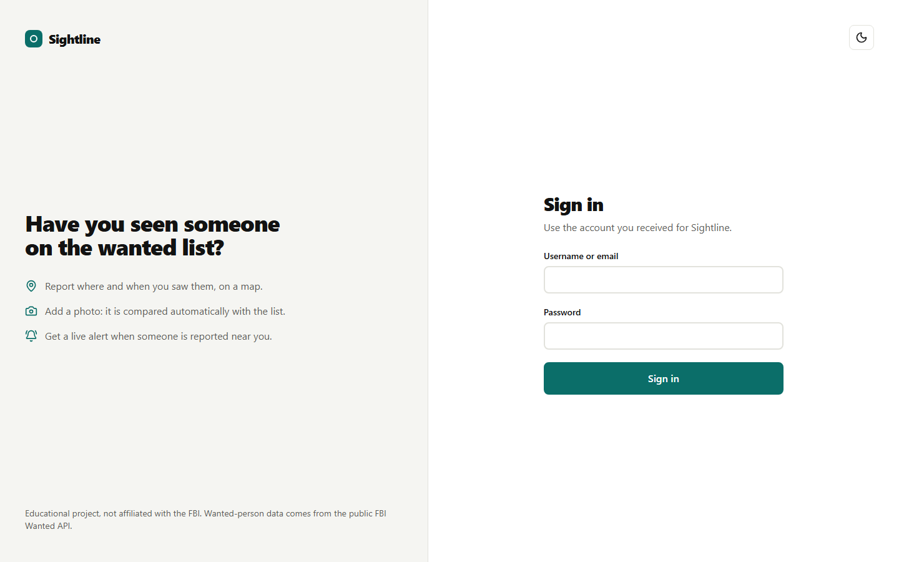
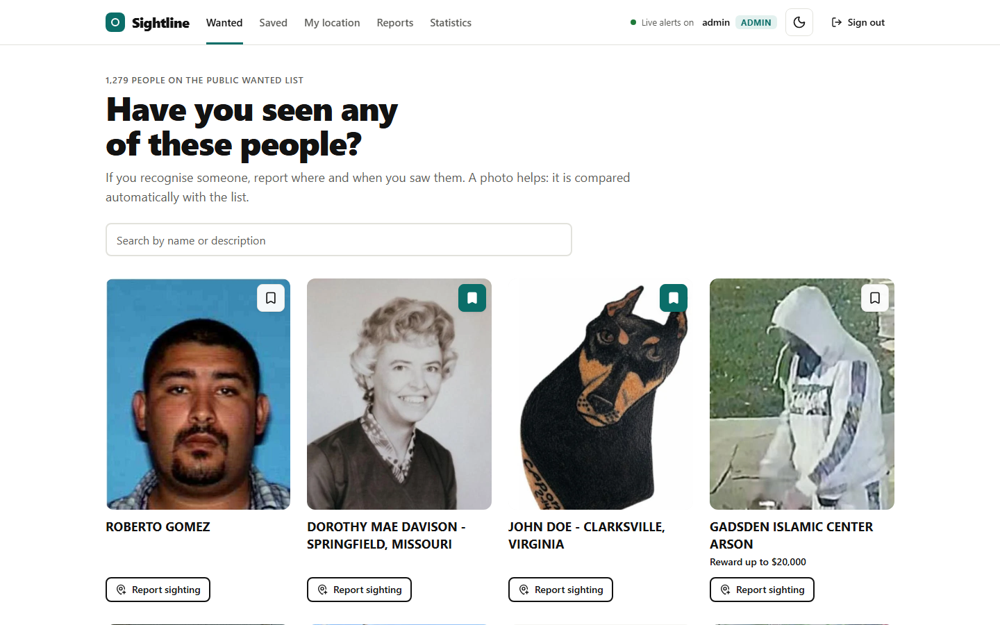
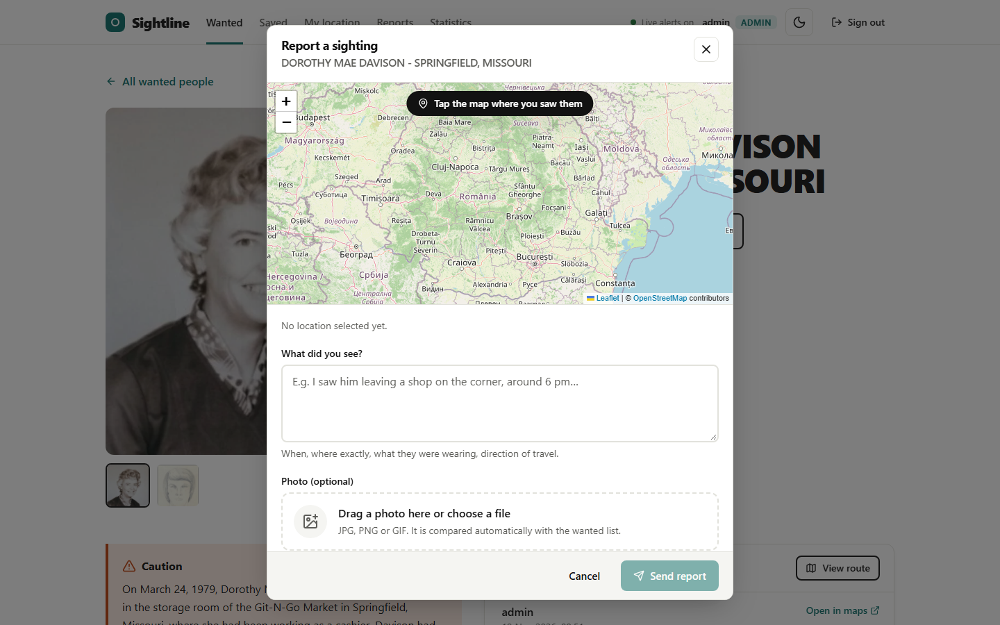
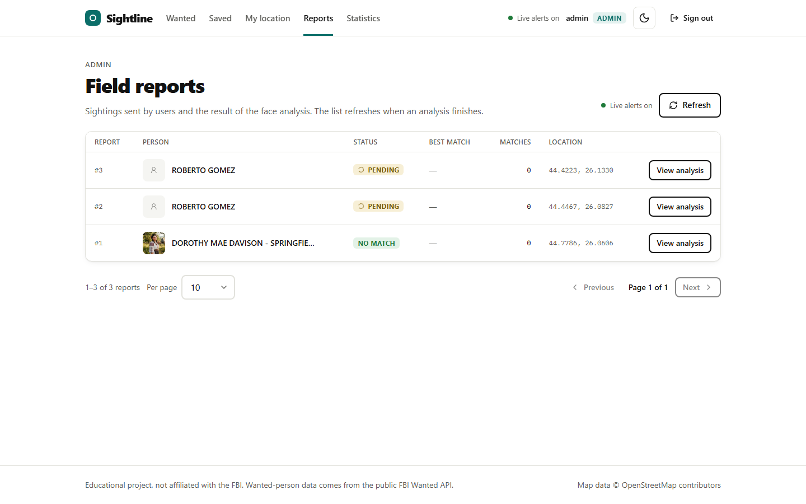
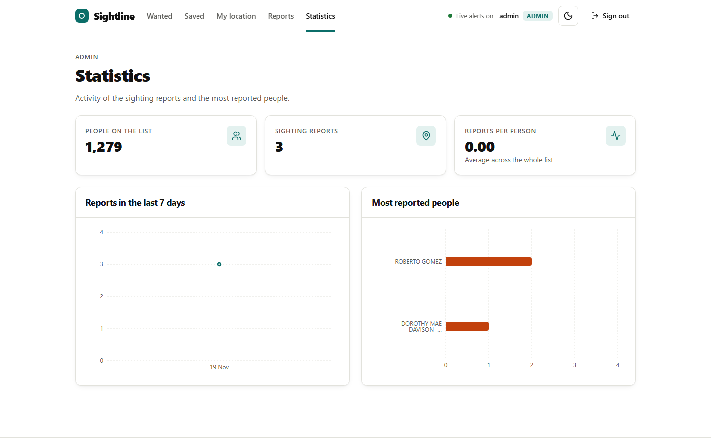
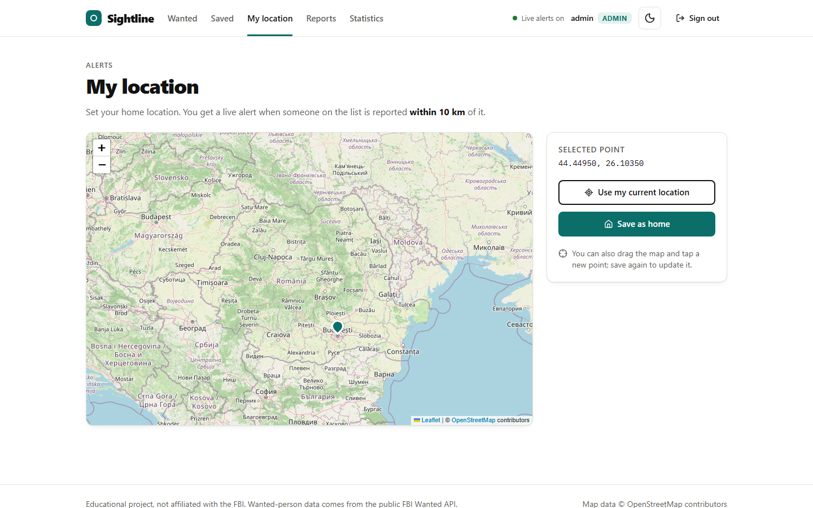
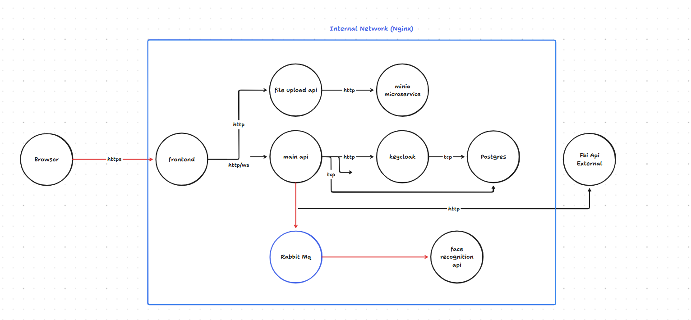

# Propunere: Sightline, raportare de observări cu recunoaștere facială

## Pe scurt

**Sightline** este o aplicație web în care utilizatorii raportează că au văzut o persoană căutată: încarcă o fotografie și marchează locul pe hartă. Sistemul analizează automat fotografia cu recunoaștere facială, o compară cu baza de persoane căutate și anunță în timp real operatorii și utilizatorii din apropiere.

Datele despre persoanele căutate sunt preluate din **API-ul public FBI Wanted**. Proiectul este o simulare educațională / de portofoliu, nu un instrument operațional.

## Problema

Când o persoană căutată e văzută, informația ajunge greu și încet la cine trebuie: telefon, e-mail, formulare, fără locație precisă și fără nicio verificare a pozei. Operatorul primește multe semnalări și nu are cum să le prioritizeze rapid.

## Soluția

| Pas | Ce se întâmplă |
|---|---|
| 1. Raportare | Utilizatorul încarcă o fotografie și alege locația pe hartă. |
| 2. Alertă imediată | Raportul apare instant la toți cei conectați. Utilizatorii aflați la mai puțin de 10 km primesc o notificare (toast + sunet). |
| 3. Analiză automată | În fundal, un serviciu AI detectează fața din poză și o compară cu fețele persoanelor căutate (top 5 potriviri, cu scor de similaritate). |
| 4. Rezultat | Raportul e marcat ca procesat, potrivirile sunt salvate, iar interfața se actualizează singură. |

Raportarea nu așteaptă analiza AI: utilizatorul primește confirmarea imediat, iar recunoașterea rulează în fundal.

## Cum arată aplicația

### Autentificare

Conturi cu roluri (utilizator / administrator). Ecranul de login explică pe scurt ce face aplicația.

### Lista persoanelor căutate

Peste 1.200 de persoane, sincronizate automat zilnic din API-ul FBI, cu căutare după nume sau descriere. Orice persoană poate fi salvată în lista proprie de urmărire sau raportată direct din card.

### Pagina unei persoane

Fotografii, descrierea cazului, istoricul observărilor (cu poză, adresă estimată și link spre hartă) și traseul lor pe hartă. Din această pagină se poate descărca un **dosar PDF** cu toate datele.

### Raportarea unei observări

Utilizatorul alege punctul pe hartă, descrie ce a văzut și, opțional, atașează o fotografie, care e comparată automat cu lista.

### Rapoarte (administrator)

Toate observările primite, cu statusul analizei faciale, cea mai bună potrivire și numărul de potriviri. Lista se actualizează singură când se termină o analiză.

### Statistici (administrator)

Câte rapoarte au venit în ultimele 7 zile și care sunt persoanele cele mai raportate.

### Locația mea

Utilizatorul își setează zona de domiciliu și primește alertă live când cineva din listă e raportat la mai puțin de 10 km.

> Capturile sunt din mediul de test, cu date puține. De aceea graficele sunt aproape goale și rapoartele nu au încă potriviri.

## Ce demonstrează proiectul

- **Arhitectură distribuită**: mai multe servicii, în limbaje diferite (.NET + Python), legate prin mesagerie asincronă.
- **AI aplicat**: un pipeline real de recunoaștere facială (detecție, embedding, căutare după similaritate), nu doar un apel la un API extern.
- **Timp real**: notificări push către utilizatori, filtrate geografic.
- **Securitate**: autentificare centralizată, roluri, chei API între servicii, HTTPS.
- **DevOps**: imagini construite local și livrate pe server, deploy și rollback cu scripturi, backup automat zilnic, verificări de sănătate.

## Stadiu actual

- Aplicația rulează complet în Docker, local și în producție pe un VPS cu domeniu și HTTPS.
- Există documentație tehnică pentru dezvoltare și producție (`docs/`).
- Indexul facial este limitat implicit la 100 de persoane, ca să rămână rapid pe un server mic. Limita se poate ridica din configurare.
- Nu există încă teste automate.

## Direcții de extindere

- **Moderare**: un ecran pentru operatori care confirmă sau resping potrivirile AI înainte de orice alertă.
- **Indexul facial într-o bază vectorială** (de ex. pgvector), ca să scaleze la mii de persoane.
- **Aplicație mobilă** cu fotografie directă și locație GPS automată.
- **Alte surse de date** (de ex. Interpol Red Notices, care au tot API public).
- **Teste automate și CI**.
- **Jurnal de audit**: cine a văzut ce raport și când.

## Limite și aspecte etice

- Recunoașterea facială dă **potriviri probabile, nu identificări**. Orice rezultat trebuie verificat de un om.
- Fotografiile încărcate pot conține persoane nevinovate. Un sistem real ar avea nevoie de politici de retenție și ștergere a datelor, conforme cu GDPR.
- Datele FBI sunt publice, dar proiectul nu este afiliat cu FBI și nu trimite nimic către autorități.

---

## Anexă: arhitectura tehnică

| Componentă | Tehnologie | Rol |
|---|---|---|
| Frontend | Next.js 16, React 19, Tailwind, Leaflet, Recharts | Interfața web, hărți, grafice |
| Backend | .NET 9, EF Core, PostgreSQL, SignalR, MassTransit | API principal, logică, notificări în timp real, import FBI |
| Serviciu AI | Python, FastAPI, DeepFace (Facenet) | Recunoaștere facială |
| Serviciu de fișiere | .NET, stocare compatibilă S3 | Încărcarea și servirea fotografiilor |
| Infrastructură | Keycloak, RabbitMQ, PostgreSQL, Nginx + HTTPS | Identitate, cozi de mesaje, bază de date, reverse proxy |

Serviciile comunică prin **cozi de mesaje (RabbitMQ)**, deci analiza AI poate fi lentă sau poate cădea fără să blocheze restul aplicației.
